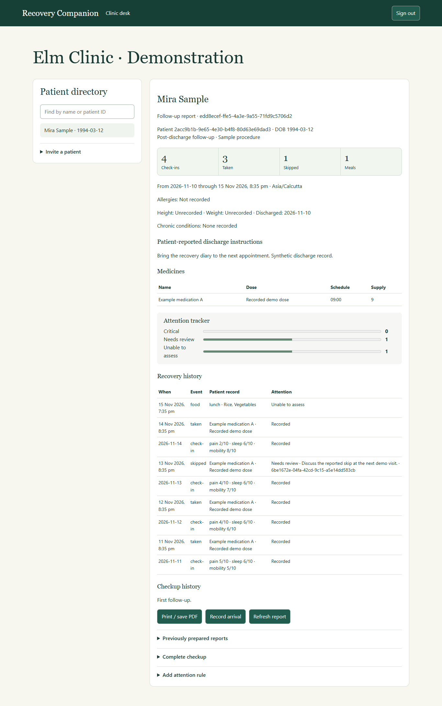

# Recovery Companion

A discharged patient keeps a recovery diary on Android. At the next visit, clinic staff open that patient's record on a laptop and print the interval since the previous completed checkup. A clinician can finalize the visit or append a correction. The patient can read both records.



[View the installed Android app](docs/demo/patient-home.png) · [Open the sample doctor handout (PDF)](docs/demo/follow-up.pdf) · [See verification and remaining release work](ACCEPTANCE.md)

## Install the local edition

The combined kit is `dist/Recovery-Companion.zip`. Extract it on Windows, open **Open sample clinic.cmd** to try the workflow, and install **Recovery-Companion-Android.apk** on the Android device. **START HERE.txt** gives the clinic login, connection and backup steps. Rebuild the combined kit with `backend/venv/Scripts/python.exe tools/package-windows.py --include-android` after producing the signed APK.

The release folder contains a signed Android APK and a portable 64-bit Windows station. Extract the station ZIP and open **Open sample clinic.cmd** for a disposable synthetic clinic, or **Open my clinic.cmd** for a persistent local database. The station includes its own Python runtime. First launch of the persistent edition prompts for your station administrator email and a private password. At the clinic desk, choose **Station administrator**, sign in, and expand **Create a clinic**. Enter the clinic name and its first clinician’s name, email and password. The clinician can then use the ordinary staff sign-in. **Add clinic staff.cmd** provisions additional staff for an existing clinic.

The administrator can search and read all active patient profiles, including unlinked patients. Deleting a clinic disables its staff membership, removes invitations and disconnects patients. A new clinic with the same name gets its own identity and fresh permissions. For patient self-service, choose **Patient account** on the website to create a profile or sign in and delete your own. Deletion removes the active profile and diary. Previously prepared reports, signed records, audit history and existing backups are retained.

Install the release APK and select the clinic server on the sign-in screen. The default address connects an emulator to the station on the same laptop. A USB-connected Android phone can use Android platform-tools with `adb reverse tcp:8000 tcp:8000` and the address `http://127.0.0.1:8000`. Remote clinic installations require HTTPS. The Android signing identity for local distribution stays in the current Windows user's profile.

The persistent station stores its SQLite database and settings under `%LOCALAPPDATA%\RecoveryCompanion\clinic`. Its optional Google key belongs in the .env there. The sample disables Gemini. The included START HERE.txt covers private backups, restoring into a new folder, login and linking a patient.

## Run from source

On this laptop, run `.\tools\run-demo.ps1 -Android` from the project folder to open the Android emulator and start the synthetic clinic. For the clinic desk alone, run the following in PowerShell:

```powershell
cd backend
.\venv\Scripts\python.exe demo.py
```

Open **http://127.0.0.1:8000/clinic/**. Sign in as **doctor@example.org** with the temporary password printed in the terminal. Select **Mira Sample**. Print the report or save it as PDF, finalize a checkup, then open a previously prepared report to see its original contents. On the Android emulator, use **patient@example.org** and the same temporary password. The demonstration starts with a fresh synthetic database each time.

For a new checkout, create the backend environment first:

```powershell
cd backend
py -3.12 -m venv venv
.\venv\Scripts\python.exe -m pip install -r requirements.txt
.\venv\Scripts\python.exe demo.py
```

## Android

The local debug APK is in `dist/app-debug.apk`. It connects to the demo on the laptop through the Android Emulator address `10.0.2.2:8000`. Start an Android emulator and run `adb install -r dist/app-debug.apk` from the repository root. A fresh installation can register a patient and complete discharge intake.

Build from the repository root using Flutter, Java 17 and the Android SDK:

```powershell
.\tools\build-android.ps1
```

To test over USB on a physical Android phone, enable USB debugging, connect the phone, start the backend, and run:

```powershell
adb reverse tcp:8000 tcp:8000
.\tools\build-android.ps1 -ApiBaseUrl http://127.0.0.1:8000
adb install -r dist/app-debug.apk
```

For distribution the build helper accepts `-Release -ApiBaseUrl https://your-clinic-host`. Supply the path to your signing keystore in `RC_KEYSTORE` and the corresponding `RC_STORE_PASSWORD`, `RC_KEY_ALIAS` and `RC_KEY_PASSWORD` through the local environment.

## What patients and staff can do

- Record a discharge profile, prescriptions, allergies, food instructions, doses taken or explicitly skipped, meals and daily symptom scores. Review voice-assisted check-in values before submitting. Permission-based device reminders can be enabled in the app.
- See symptom history alongside a tracker for explicitly skipped medicines and recorded foods. A clinician specifies the exact name, attention level and reason. An unmatched event displays **Unable to assess**. Missing entries stay distinct from skipped doses.
- Link a clinic through an expiring invitation issued for the patient's account email. The patient previews and confirms the clinic and can revoke access.
- Search linked patients, mark an arrival, prepare a dated report and reprint its saved snapshot. Printing leaves the interval open. Finalizing the checkup starts the next interval. Late uploads are identified in the report.

## Keep a local database

From `backend`, copy `.env.example` to `.env` on a fresh checkout. Set a private, persistent `SECRET_KEY` for sessions. The default database is SQLite. An explicit `DATABASE_URL` can select PostgreSQL with the `postgresql+asyncpg` driver. For a new database:

```powershell
.\venv\Scripts\python.exe -m alembic upgrade head
.\venv\Scripts\python.exe manage.py --role administrator --email admin@example.org
.\venv\Scripts\python.exe -m uvicorn app.main:app --host 127.0.0.1 --port 8000
```

The staff command prompts for the password. Use the clinic desk to issue an invitation and enter it in the patient's Records tab. The receptionist role can retrieve reports and record arrival. Clinical rules, checkup finalization and amendments require the clinician role.

## Verify the Android and clinic connection

Install the signed APK on a dedicated Android emulator. Start at its signed-out screen and leave port 8000 free for the disposable clinic. From the repository root, run the following with ADB on PATH and Playwright and Edge installed. Set the ADB environment variable to the executable path if needed.

~~~powershell
$env:RC_TEST_OFFLINE = '1'
$env:RC_TEST_CLINIC_BROWSER = '1'
.\backend\venv\Scripts\python.exe tools\verify-android.py
~~~

The test signs in a synthetic patient, saves a meal offline, restarts the app, and verifies exactly one receipt after reconnecting. Edge opens the linked patient, finds the meal, and finalizes a checkup. Reopening Records on Android must show the clinician’s new note. Use the refresh button if staff complete a checkup while Records is already open.

## Optional Google integration


For the persistent server, paste your own Google AI Studio key after `GEMINI_API_KEY=` in `backend/.env` and restart the backend. The template selects `gemini-flash-latest`; change `GEMINI_MODEL` to select another supported model. The local demonstration always disables Gemini. Manual entry, sync and clinic reports run without a key. Live model responses and free-tier availability for a particular Google account require separate verification.

## Verification

From `backend`, run `.\venv\Scripts\python.exe -m unittest discover -s tests -q`. To rehearse with a disposable PostgreSQL cluster, set `PG_BIN` to the installation's bin directory and run `.\venv\Scripts\python.exe tests/verify_postgres.py`. The Android build helper runs the Flutter widget tests before packaging. With Playwright and Edge or Chromium available, run `node tools/verify-clinic.cjs` from the repository root to regenerate the synthetic screenshot and handout.

The release packages support the local patient and clinic workflow. Real-patient operation still requires physical device checks, site-specific clinical review and a review of the operator's security, access, and retention practices. See [ACCEPTANCE.md](ACCEPTANCE.md) for the evidence.

## Reproduce the packages

Run `tools/build-local-release.ps1` with Flutter, Android SDK and JAVA_HOME set to Java 17. The helper creates or reuses a local sideload signing identity. For an independently managed distribution key, use the release flags in the Android section. Run `backend/venv/Scripts/python.exe tools/package-windows.py` from a Windows checkout to bundle the tested interpreter and clinic dependencies. Run `tools/verify-station.py` with that Python to extract the ZIP and check the restored clinic.

For the container stack, set a URL-safe random RC_DB_PASSWORD in the process environment, and set a private persistent SECRET_KEY in backend/.env before starting Compose. The API binds to localhost. PostgreSQL and Redis stay on the private Compose network. Configure RC_API_HOSTS when connecting an HTTPS proxy.
